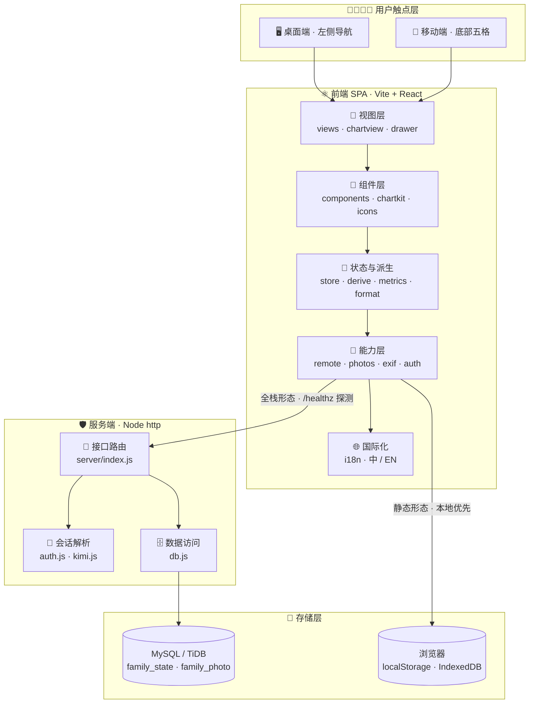

<!-- markdownlint-disable MD033 MD041 -->

<p align="center">
  
</p>

<h1 align="center">YanYuCloudCube-MoChen</h1>

<p align="center">
  <b>宝宝成长日志 · 家庭共享版</b><br />
  <i>Baby Growth Log · Family Shared Edition</i>
</p>

<p align="center">
  <b>言启象限 | 语枢未来</b><br />
  <i>Words Initiate Quadrants, Language Serves as Core</i><br />
  万象归元于云枢 | 深栈智启新纪元<br />
  <i>All things converge in cloud pivot; Deep stacks ignite a new era of intelligence</i>
</p>

<p align="center">
  <a href="https://github.com/YYC-Cube/YYC3-Baby-MoChen"></a>
  
  
  
</p>

<p align="center">
  
  
  
  
  = 20" />
  
  
  
</p>

<p align="center">
  
  
  
  
</p>

---

## 目录

- [目录](#目录)
- [项目定位](#项目定位)
- [核心能力](#核心能力)
  - [四大主视图](#四大主视图)
  - [记录与统计](#记录与统计)
  - [家庭与账号](#家庭与账号)
  - [体验与工程](#体验与工程)
- [技术栈](#技术栈)
- [系统架构](#系统架构)
  - [分层架构图](#分层架构图)
  - [图标化模块地图](#图标化模块地图)
  - [关键数据流](#关键数据流)
- [快速开始](#快速开始)
  - [环境要求](#环境要求)
  - [本地开发](#本地开发)
  - [构建与运行](#构建与运行)
  - [常用脚本](#常用脚本)
- [目录结构](#目录结构)
- [配置与环境变量](#配置与环境变量)
  - [构建期常量](#构建期常量)
  - [服务端运行时](#服务端运行时)
- [数据模型与接口](#数据模型与接口)
  - [数据表](#数据表)
  - [HTTP 接口](#http-接口)
  - [服务端防护](#服务端防护)
- [部署形态](#部署形态)
- [工程规范体系](#工程规范体系)
  - [五维驱动 → 五高五标五化](#五维驱动--五高五标五化)
  - [编码约定](#编码约定)
  - [分支与提交](#分支与提交)
- [质量门禁](#质量门禁)
- [文档地图](#文档地图)
- [贡献与安全](#贡献与安全)
- [许可证与联系](#许可证与联系)

---

## 项目定位

**YanYuCloudCube-MoChen** 是一款面向家庭的婴幼儿成长记录应用：记录喂养、睡眠、护理、健康与成长数据，自动生成图表与统计，支持成长相册、家庭成员共享与多账号数据隔离。桌面端采用左侧导航，移动端采用底部五格标签栏，同一套代码同时产出**静态站**与**全栈站**两种形态。

> **设计基调**：近白底 + 薰衣草紫，圆润字体与低饱和插画；不追求模板化的「圆角卡片堆叠」，以留白、发丝线与分级圆角建立层级。

| 项目属性 | 值 |
| --- | --- |
| 应用标识 | `yanyucloudcube-mochen` |
| 当前版本 | `1.0.0` |
| 运行形态 | Vite SPA + 可选 Node 服务端 |
| 数据形态 | 本地优先；全栈形态下按家庭同步 |
| 界面语言 | 中文 / English（运行时切换，构建期可设默认语言） |
| 开发端口 | `3030` 起（团队约定） |
| 生产端口 | `3000`（平台运行契约） |
| 代码仓库 | [github.com/YYC-Cube/YYC3-Baby-MoChen](https://github.com/YYC-Cube/YYC3-Baby-MoChen)（镜像：内网 Git `origin`） |

---

## 核心能力

### 四大主视图

| 视图 | 图标 | 职责 |
| --- | --- | --- |
| 图表 Charts | 📊 | 14 类可量化记录 × 5 种图表形态 × 天/周/月三种粒度，支持下钻查看原始记录 |
| 今日 Today | 🏠 | 日期条、睡眠计时器、当日统计、近七天睡眠柱状图、记录时间线、可编辑指标卡 |
| 相册 Album | 🖼 | 按月分组的成长时间轴，缩略图标注当月月龄，点开看大图与当日摘要 |
| 家庭 Family | 👨‍👩‍👧‍👦 | 成员列表、身份切换、贡献条、常用记录类型、头像自定义 |

### 记录与统计

- **15 类记录**，分为喂养、作息、护理、健康、记录五组：亲喂、瓶喂、换尿布、吸奶、母乳库存、睡眠、体温、身高体重、用药、辅食、补剂、随手记、照片、黄疸、疫苗。
- **声明式扩展**：记录字段由 [`src/data.js`](./src/data.js) 声明，图表形态由 [`src/charts.js`](./src/charts.js) 的 `chartSpecs` 声明；新增类型只需改这两处。
- **五种图表**：`session` 睡眠区间、`bar` 每日合计、`stack` 分类堆叠、`line` 折线、`marker` 事件标记。
- **自动派生**：月龄、距上次记录时长、当日汇总、家庭贡献统计均由 [`src/derive.js`](./src/derive.js) 与 [`src/metrics.js`](./src/metrics.js) 计算。

### 家庭与账号

- **家庭共享**：同一家庭的数据落在同一行状态中，多账号实时同步（防抖 600ms）。
- **严格隔离**：接入登录后家庭 id 以服务端会话为准，忽略前端传入的 `?family=`，避免越权读取。
- **乐观并发**：写入携带 `revision`，冲突返回 `409` + 服务端当前状态，前端以服务端为准回落。
- **身份体系**：登录后身份跟随账号，记录与照片署名到本人；成员可改显示名与身份描述。

### 体验与工程

- **本地优先**：未配置数据库时自动退回 `localStorage` + `IndexedDB`，页面不白屏。
- **双语与主题**：中英文案集中于 [`src/i18n.js`](./src/i18n.js)；浅色 / 深色 / 跟随系统。
- **EXIF 自动时间**：手写 EXIF 解析器读取 `DateTimeOriginal`，无第三方依赖。
- **零 UI 框架**：仅 React 原生状态，无状态管理库、无组件库、无动画库。

---

## 技术栈

| 层级 | 技术 | 版本 / 说明 | 用途 |
| --- | --- | --- | --- |
| 视图 | React | `^19.2.8` | 单页应用、函数组件 + Hooks |
| 构建 | Vite | `^6.3.5` | 开发服务器、生产构建、编译期常量摇树 |
| 打包 | esbuild | `^0.25.12` | 服务端单文件打包（含 `mysql2` 内联） |
| 服务端 | Node.js `http` / `fs` | Node ≥ 20 | 静态托管 + JSON / 二进制接口 |
| 数据库 | MySQL / TiDB | `mysql2 ^3.24.3` | 家庭状态与照片位图持久化 |
| 样式 | 原生 CSS | `src/styles.css`、`src/kit.css` | CSS 变量主题、响应式、按压反馈 |
| 字体 | Nunito Variable / Noto Sans SC Variable | 自托管 `woff2`，SIL OFL | 英文数字 / 中文正文与标题 |
| 包管理 | npm | `package-lock.json` | 依赖锁定与脚本编排 |

> 本项目**不是** Next.js / shadcn/ui 技术栈，也不使用 pnpm；所有架构说明均以仓库实际代码为准。

---

## 系统架构

### 分层架构图



### 图标化模块地图

| 图标 | 层级 | 核心文件 | 职责边界 |
| --- | --- | --- | --- |
| 🖥 / 📱 | 触点 | [`src/main.jsx`](./src/main.jsx) | 路由、主题、语言、登录闸、同步编排 |
| 🎨 | 视图 | [`src/views.jsx`](./src/views.jsx)、[`src/chartview.jsx`](./src/chartview.jsx) | 今日 / 相册 / 家庭 / 图表四个主视图 |
| 🧩 | 组件 | [`src/components.jsx`](./src/components.jsx)、[`src/drawer.jsx`](./src/drawer.jsx) | 头卡、弹层、表单抽屉、记录详情、头像 |
| 🧠 | 状态 | [`src/store.js`](./src/store.js)、[`src/derive.js`](./src/derive.js) | 状态出厂值、持久化、迁移兜底、统计派生 |
| 🔌 | 能力 | [`src/remote.js`](./src/remote.js)、[`src/photos.js`](./src/photos.js) | 服务端同步、照片位图、EXIF、会话 |
| 🌐 | 国际化 | [`src/i18n.js`](./src/i18n.js) | 文案、无障碍标签、枚举值渲染时翻译 |
| 🚏 | 接口 | [`server/index.js`](./server/index.js) | 静态托管、API、限流、路径穿越防护 |
| 🔐 | 鉴权 | [`server/auth.js`](./server/auth.js)、[`server/kimi.js`](./server/kimi.js) | Cookie 会话、Header 注入、JWT 钩子、OAuth |
| 🗄 | 数据 | [`server/db.js`](./server/db.js) | 建表、乐观并发写入、照片读写 |
| 💾 | 存储 | MySQL / TiDB + 浏览器 | 全栈共享存储 / 单机本地存储 |

### 关键数据流

```text
记录输入 → data.js 声明字段 → saveRecord 写入状态
        → derive.js 计算统计 → 视图渲染 / 图表聚合
        → store.js 落 localStorage → remote.js 防抖推送（全栈形态）

照片选择 → 内存预览 → 保存时读 EXIF 拍摄时间
        → photos.js 写 IndexedDB → 记录仅存照片 id
        → remote.js 上传位图（全栈形态）
```

---

## 快速开始

### 环境要求

- Node.js **≥ 20**（推荐 20 LTS / 22 LTS）
- npm（仓库使用 `package-lock.json`）
- 可选：MySQL 8+ 或 TiDB（仅全栈形态需要）

### 本地开发

```bash
# 1. 安装依赖
npm install

# 2. 启动开发服务器（团队约定 3030 起）
npm run dev -- --host 0.0.0.0 --port 3030
```

打开 `http://localhost:3030`。

> 未配置登录与数据库时，应用会进入「登录服务不可用」或本地存储形态；这是预期的降级行为，不是白屏故障。

### 构建与运行

```bash
# 生产构建（前端 + 服务端 bundle）
npm run build

# 仅构建服务端
npm run build:server

# 启动生产服务（默认端口 3000）
npm start
```

### 常用脚本

| 命令 | 作用 | 产物 |
| --- | --- | --- |
| `npm run dev` | Vite 开发服务器 | 内存 |
| `npm run build` | 全栈构建 + 生成 `boot.js` | `dist/` |
| `npm run build:static` | 仅前端构建（静态形态，摇掉远端同步逻辑） | `dist/` |
| `npm run build:kimix` | 全栈构建 + 服务端打包 | `dist/` |
| `npm run build:server` | esbuild 打包服务端 | `dist-server/boot.js` |
| `npm run preview` | 预览生产构建 | 本地预览 |
| `npm run bundle` | 默认打包（全栈） | `.bundle/*.zip` |
| `npm run bundle:template` | 模板打包 | `.bundle/*.zip` |
| `npm run bundle:kimix` | kimix 源树打包 | `.bundle/*.zip` |
| `npm start` | 启动打包后的服务端 | 运行中 |

---

## 目录结构

```text
YYC3-Baby-MoChen/
├── public/
│   ├── assets/                 # 插画、头像、字体、图标等静态资产
│   └── yyc3-family.png         # 文档顶图 / 品牌家族图
├── src/
│   ├── main.jsx                # 应用入口：路由、主题、语言、登录闸、同步
│   ├── views.jsx               # 今日 / 相册 / 家庭视图
│   ├── chartview.jsx           # 图表视图与下钻
│   ├── chartkit.jsx            # 图表绘制组件
│   ├── charts.js               # 图表声明与聚合
│   ├── components.jsx          # 通用组件、头像、头卡、弹层
│   ├── drawer.jsx              # 表单抽屉、记录详情、宝宝资料
│   ├── data.js                 # 记录类型与字段声明
│   ├── store.js                # 状态出厂值、持久化、迁移
│   ├── derive.js               # 统计派生
│   ├── metrics.js              # 指标卡定义
│   ├── remote.js               # 服务端同步客户端
│   ├── photos.js               # IndexedDB 照片位图
│   ├── exif.js                 # EXIF 拍摄时间解析
│   ├── auth.js                 # 前端会话接入层
│   ├── i18n.js                 # 中英文案与翻译函数
│   ├── family.js               # 家庭成员与宝宝资料
│   ├── format.js               # 时间与格式工具
│   ├── icons.jsx               # 图标集
│   ├── kit.css                 # 设计令牌与基础样式
│   └── styles.css              # 全站样式与响应式
├── server/
│   ├── index.js                # HTTP 服务：静态托管 + API
│   ├── auth.js                 # 会话解析（kimi / header / jwt）
│   ├── kimi.js                 # OAuth 授权码流程与 JWT 签发
│   └── db.js                   # MySQL / TiDB 数据访问
├── scripts/
│   ├── build-boot.mjs          # 构建 boot.js + 服务端 bundle
│   ├── build-server.mjs        # 独立服务端打包
│   ├── bundle.mjs              # 静态 / 全栈 zip 打包
│   └── bundle-kimix.mjs        # kimix 源树打包
├── deploy/                     # 落地部署产物与指导方案（compose / systemd / 备份）
│   ├── README.md               # 完整落地上线指导方案（现网实测拓扑）
│   ├── docker-compose.yml      # ECS 公网方案：Caddy + app + MySQL 8.4
│   ├── Dockerfile              # 全栈镜像（boot.js 自包含，免 npm install）
│   ├── Caddyfile               # 反向代理与自动 HTTPS
│   ├── baby-mochen.service     # 裸机 systemd 单元（NAS / 无 docker 环境）
│   ├── backup.sh               # 每日全库备份（轮转 + 可选异地 rsync）
│   └── .env.example            # 运行配置模板
├── docs/                       # 团队标准规范与项目文档
├── public/                     # Vite 静态资源根
├── index.html                  # HTML 入口
├── vite.config.js              # 构建配置与编译期常量
├── package.json                # 依赖与脚本
├── bootstrap                   # 平台运行时启动脚本
└── serve.sh                    # 本地服务脚本（3030 起）
```

---

## 配置与环境变量

### 构建期常量

| 变量 | 取值 | 作用 |
| --- | --- | --- |
| `BUILD_TARGET` | `fullstack` / 空 | 决定 `__SHARED_BACKEND__`；空值为静态站，整段远端逻辑被摇树移除 |
| `DEFAULT_LANG` | `en` / 空 | 决定首屏默认语言 `__DEFAULT_LANG__`，用户仍可在设置内切换 |

### 服务端运行时

| 变量 | 默认值 | 说明 |
| --- | --- | --- |
| `PORT` | `3000` | 服务监听端口 |
| `STATIC_DIR` | 同级 `dist/` | 前端产物目录 |
| `DATABASE_URL` | 无 | MySQL / TiDB 连接串；未配置时退回本地存储 |
| `APP_ID` / `APP_SECRET` | 无 | kimi OAuth 应用凭据 |
| `KIMI_AUTH_URL` / `KIMI_OPEN_URL` | 无 | 授权页与用户信息端点 |
| `AUTH_HEADER_USER` | 无 | 反向代理注入的用户标识头（如 `X-Forwarded-User`） |
| `AUTH_HEADER_NAME` / `AUTH_HEADER_EMAIL` / `AUTH_HEADER_FAMILY` | 无 | 对应的姓名 / 邮箱 / 家庭头 |
| `AUTH_JWKS_URL` | 无 | Bearer JWT 验签公钥地址（JWKS）；支持 RS256 / ES256 / ES384 / ES512，公钥缓存 10 分钟 |
| `AUTH_SIGNIN_URL` | 无 | 登录入口地址（header / jwt 模式） |
| `AUTH_FAMILY_CLAIM` | `family_id` | JWT 中作为家庭 id 的字段 |

> **安全约定**：所有凭据只通过环境变量注入，不写入仓库、不打包进 zip、不进入前端状态。

---

## 数据模型与接口

### 数据表

```sql
-- 一个家庭一行，整份状态存 JSON；revision 用于乐观并发
CREATE TABLE IF NOT EXISTS family_state (
  family_id   VARCHAR(64)  NOT NULL,
  revision    BIGINT       NOT NULL DEFAULT 0,
  payload     LONGTEXT     NOT NULL,
  updated_by  VARCHAR(64)  NULL,
  updated_at  TIMESTAMP    NOT NULL DEFAULT CURRENT_TIMESTAMP ON UPDATE CURRENT_TIMESTAMP,
  PRIMARY KEY (family_id)
);

-- 照片位图独立成表，避免读状态时拖出数 MB 图
CREATE TABLE IF NOT EXISTS family_photo (
  family_id   VARCHAR(64)  NOT NULL,
  blob_id     VARCHAR(128) NOT NULL,
  mime        VARCHAR(64)  NOT NULL DEFAULT 'image/jpeg',
  bytes       LONGBLOB     NOT NULL,
  created_at  TIMESTAMP    NOT NULL DEFAULT CURRENT_TIMESTAMP,
  PRIMARY KEY (family_id, blob_id)
);
```

### HTTP 接口

| 方法 | 路径 | 说明 |
| --- | --- | --- |
| `GET` | `/healthz` | 探活，返回 `{ ok, db }`；`db` 表示 schema 是否就绪 |
| `GET` | `/api/state?family=` | 读取家庭状态；无数据返回 `{ revision: 0, payload: null }` |
| `PUT` | `/api/state` | 写入状态，body 含 `revision` / `payload` / `memberId`；冲突返回 `409` |
| `GET` | `/api/photo/:id` | 读取照片位图（长缓存 `immutable`） |
| `PUT` | `/api/photo/:id` | 上传照片位图（上限 12 MiB，MIME 白名单校验，白名单外 `415`） |
| `DELETE` | `/api/photo/:id` | 删除照片位图 |
| `GET` | `/api/auth/session` | 当前登录能力与用户信息 |
| `GET` | `/api/auth/signin` | 跳转授权页（kimi 模式） |
| `GET` | `/api/oauth/callback` | OAuth 回调，换取 token 并种下会话 Cookie |
| `POST` | `/api/auth/signout` | 清除本站会话 Cookie |

### 服务端防护

| 防护 | 实现 |
| --- | --- |
| 限流 | 写操作 60 次/分钟，读操作 300 次/分钟；优先按会话 `userId` 计数 |
| 请求体上限 | 状态 8 MiB，照片 12 MiB，超限返回 `413` |
| 路径穿越 | `resolve` 后校验目标仍在站点根目录内 |
| 未登录写入 | 接入 auth 后，数据接口一律 `401`；被拒请求仍会排空请求体 |
| 家庭隔离 | 家庭 id 由会话推导，前端 `?family=` 仅在无 auth 时生效 |
| 照片类型白名单 | 上传仅接受 `image/jpeg` / `image/png` / `image/webp` / `image/gif`，白名单外返回 `415`；存量白名单外记录读取时兜底为 `application/octet-stream` |
| 安全响应头 | 全部响应带 `X-Content-Type-Options: nosniff`，防止用户上传内容被嗅探成可执行类型 |
| Bearer JWT 验签 | `AUTH_JWKS_URL` 拉取 JWKS 验签（RS256 / ES256 / ES384 / ES512，公钥缓存 10 分钟），验不过一律 `401` |
| 数据最小化 | 前端账号对象只保留 `userId` / `name` / `email` / `familyId` / `avatar` |

---

## 部署形态

| 形态 | 构建 | 存储 | 适用场景 |
| --- | --- | --- | --- |
| 静态站 | `BUILD_TARGET=` 空 | `localStorage` + `IndexedDB` | 纯前端托管、个人单机使用 |
| 全栈站 | `BUILD_TARGET=fullstack` | MySQL / TiDB + 服务端 | 家庭共享、多设备同步 |
| kimix | `npm run bundle:kimix` | 平台注入 `DATABASE_URL` | 平台 Docker 构建发布 |
| GitHub Pages | 推送 `main` 自动触发 [pages.yml](.github/workflows/pages.yml) | `localStorage` + `IndexedDB` | 公网演示站：[mc.yyc3.vip](https://mc.yyc3.vip)（自定义域名，CI 质量门禁见 [ci.yml](.github/workflows/ci.yml)） |

```bash
# 静态包
node scripts/bundle.mjs static

# 全栈包
node scripts/bundle.mjs fullstack

# kimix 源树包
npm run bundle:kimix
```

**运行契约（不要破坏）**：

- 平台开发固定执行 `npm run dev -- --host 0.0.0.0 --port <平台端口>`；
- 平台发布固定执行 `npm run build`，并以 `node dist/boot.js` 启动；
- `dist/boot.js` 会读取同级 `.env` 作为默认值，真实环境变量优先；
- 服务端监听 `PORT`，平台默认 `3000`；
- 构建产物中的 `index.html` 使用 `no-cache`，带哈希资源使用 `immutable` 长缓存。

---

## 工程规范体系

### 五维驱动 → 五高五标五化

| 维度 | 在本项目中的落点 |
| --- | --- |
| 时间维度 | 开发启动 ≤ 3030 端口规范；`vite build` + esbuild 单文件打包；`index.html` 不缓存、资源长缓存 |
| 空间维度 | 前端按「视图 / 组件 / 状态 / 能力」分层；服务端按「路由 / 鉴权 / 数据」拆分；照片与状态分表 |
| 属性维度 | 可维护性（声明式类型与图表）、安全性（会话隔离 + 限流）、性能（摇树 + 分表 + 缓存） |
| 事件维度 | 乐观并发 + 冲突回落；登录态订阅；计时器跨刷新恢复；错误降级不白屏 |
| 关联维度 | 前端 `remote.js` ↔ 服务端接口 ↔ 数据库；EXIF ↔ 相册 ↔ 记录删除联动 |

| 体系 | 标准 | 落地 |
| --- | --- | --- |
| 五高 · 高可用 | 建表失败不阻断启动；无库退回本地；`/healthz` 明确报告存储状态 | `server/index.js`、`server/db.js` |
| 五高 · 高性能 | 编译期摇树移除远端逻辑；照片独立表；构建产物长缓存 | `vite.config.js`、`server/index.js` |
| 五高 · 高安全 | 会话驱动家庭隔离；写读限流；路径穿越防护；凭据仅环境变量 | `server/auth.js`、`server/index.js` |
| 五高 · 高扩展 | 记录类型与图表形态声明式扩展；三种鉴权接入方式；中英词条可扩展 | `src/data.js`、`src/charts.js`、`server/auth.js` |
| 五高 · 高智能 | 月龄与统计自动派生；EXIF 自动识别拍摄时间；指标卡自适应 | `src/derive.js`、`src/exif.js` |
| 五标 · 标准化 | 脚本、端口、接口、环境变量均有明确契约 | `package.json`、`server/index.js` |
| 五标 · 规范化 | 单一职责模块；数据语义与显示文案分离；注释解释「为什么」 | 全仓库 |
| 五标 · 自动化 | Vite 构建、esbuild 打包、zip 产出均由脚本驱动 | `scripts/` |
| 五标 · 可视化 | 五种图表形态；双端自适应；明暗主题；指标卡可视化编辑 | `src/chartkit.jsx`、`src/styles.css` |
| 五标 · 智能化 | 自动汇总、自动月龄、自动拍摄时间、自动冲突回落 | `src/derive.js`、`src/exif.js`、`src/remote.js` |
| 五化 · 流程化 | 开发 → 构建 → 打包 → 发布 → 验证的固定链路 | `scripts/`、`docs/` |
| 五化 · 数字化 | 记录、照片、统计、贡献全部结构化存储 | `src/store.js`、`server/db.js` |
| 五化 · 生态化 | 兼容 MySQL / TiDB、OAuth、反向代理 Header、JWT | `server/` |
| 五化 · 工具化 | npm scripts 覆盖开发、构建、打包、启动 | `package.json` |
| 五化 · 服务化 | 前端能力层与服务端接口解耦，同码双形态 | `src/remote.js`、`vite.config.js` |

### 编码约定

- **语言**：源码注释使用中文；标识符使用英文；界面文案禁止硬编码中文，统一走 `src/i18n.js`。
- **数据语义**：记录类型、字段、选项的存储值始终为中文原值，渲染时通过 `trType` / `trLabel` / `trValue` 翻译；禁止把选项值改成英文字面量。
- **扩展入口**：新增记录类型改 `src/data.js`；新增图表形态改 `src/charts.js`；新增指标卡改 `src/metrics.js`。
- **样式**：圆角阶梯 `5 / 8 / 11 / 14 / 18`；内容区不堆叠「圆角 + 描边 + 阴影」；按压反馈统一使用 CSS 曲线。
- **字体**：仅 Nunito Variable + Noto Sans SC Variable 两款自托管字体，不引入第三方字体 CDN。
- **服务端**：提前返回的分支必须 `drain(req)`；错误信息不回传内部细节；新增接口必须考虑鉴权与限流。

### 分支与提交

```text
main                ← 可发布分支
└── feat/<scope>    ← 功能
└── fix/<scope>     ← 修复
└── docs/<scope>    ← 文档
└── chore/<scope>   ← 工程杂项
```

提交信息采用 Conventional Commits：

```text
feat(charts): 支持睡眠区间跨午夜拆分
fix(sync): 冲突回落时保留服务端 revision
docs(readme): 补充架构图与环境变量
chore(build): 调整服务端打包目标版本
```

---

## 质量门禁

提交前请至少完成以下检查：

| 检查项 | 命令 | 通过标准 |
| --- | --- | --- |
| 依赖安装 | `npm install` | 无 `ERR` |
| 生产构建 | `npm run build` | 成功生成 `dist/` |
| 本地启动 | `npm run dev -- --port 3030` | 页面可打开，无控制台报错 |
| 静态检查 | `npx eslint src server`（若已配置） | 0 error |
| 安全自查 | 见 [SECURITY.md](./SECURITY.md) | 无硬编码密钥、无越权读取 |
| 双语自查 | 切换英文界面遍历主视图 | 无中文文案泄漏（数据名除外） |
| 双端自查 | 1440px / 390px 视口 | 布局无溢出、无遮挡 |

---

## 文档地图

| 文档 | 说明 |
| --- | --- |
| [README.md](./README.md) | 项目总览、架构、快速开始与规范体系 |
| [CONTRIBUTING.md](./CONTRIBUTING.md) | 贡献流程、分支规范、代码与文档要求 |
| [CODE_OF_CONDUCT.md](./CODE_OF_CONDUCT.md) | 社区行为准则与执行方式 |
| [SECURITY.md](./SECURITY.md) | 安全政策、漏洞报告与安全设计 |
| [CHANGELOG.md](./CHANGELOG.md) | 变更日志与安全修复记录 |
| [LICENSE](./LICENSE) | Apache License 2.0 |
| [info.md](./info.md) | 模板原始说明与历史设计记录 |
| [docs/全局风格令牌与图资替换指导.md](./docs/全局风格令牌与图资替换指导.md) | 设计令牌与图资替换规范 |
| [docs/YYC3-团队通用-标准规范/](./docs/YYC3-团队通用-标准规范/) | 团队标准、五维驱动、验收与文档闭环 |

---

## 贡献与安全

- 提交代码前请阅读 [CONTRIBUTING.md](./CONTRIBUTING.md)。
- 参与社区请遵循 [CODE_OF_CONDUCT.md](./CODE_OF_CONDUCT.md)。
- 发现安全漏洞请按 [SECURITY.md](./SECURITY.md) 私下报告，**不要公开提交 Issue**。

---

## 许可证与联系

本项目采用 **Apache License 2.0** 授权，详见 [LICENSE](./LICENSE)。

```text
Copyright © 2025-2026 YanYuCloudCube™. All Rights Reserved.
```

| 渠道 | 信息 |
| --- | --- |
| 联系邮箱 | [china@yanyucloud.com](mailto:china@yanyucloud.com) |
| 品牌定位 | 言启象限 · 语枢未来 |
| 核心理念 | 拟人为本，AI 为核，纯粹为心 |
| 关键词 | `baby-growth-log` `growth-tracking` `family-album` `family-shared` `react` `react19` `vite` `spa` `i18n` `mysql` `self-hosted` `github-pages` `yyc3` `yanyucloudcube` |

---

<p align="center">
  <b>YanYuCloudCube™</b><br />
  言启象限 | 语枢未来<br />
  <i>Words Initiate Quadrants, Language Serves as Core</i><br />
  万象归元于云枢 | 深栈智启新纪元<br />
  <i>All things converge in cloud pivot; Deep stacks ignite a new era of intelligence</i><br />
  <sub>© 2025-2026 YanYuCloudCube · <a href="mailto:china@yanyucloud.com">china@yanyucloud.com</a></sub>
</p>
